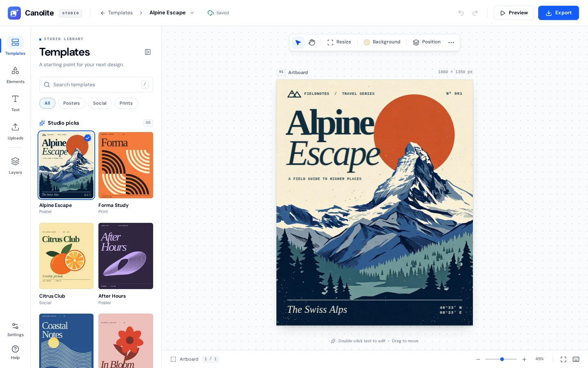

# Canolite Studio

Open any template from the dashboard to use the new editor. It uses the same authenticated template IDs, Fabric documents, dynamic fields and image/video render APIs. There is no database migration. Opening an existing design does **not** replace its artwork.

The workspace uses the dashboard’s Canolite logo, blue action and selection colors, and neutral surfaces. These styles apply only to editing controls; changing the app theme does not recolor templates, images, or exports.

## A quick tour

- **Templates:** search six original starter designs, filter by format, then choose **Use template** to replace the artboard. Undo restores the previous artwork, name and dimensions. The project's template ID stays the same.
- **Elements, Text and Uploads:** add a shape, a graphic, styled text, an image or a video. Double-click text to edit directly on the canvas. The toolbar changes with your selection; **Edit text / Edit layer** opens the full inspector.
- **Layers / Position:** select, hide, lock, or drag to reorder layers. Forward/backward controls also work without dragging. Shift-select objects for alignment controls.
- **API fields:** select a layer, open its properties and expand **API field**. The design-name menu contains **Copy template ID** and **Open in Playground**.
- **Preview:** view the design without editing handles or panels. Video designs also have timeline and clip playback controls. The footer shows the actual display scale; clicking its percentage fits the artboard to the workspace.
- **Save:** click **Save changes** or press Ctrl/⌘ S. Saving is explicit, not automatic. If another tab saved a newer version, choose **Save as copy** to keep both versions, or **Reload latest** to discard your local changes. A failed network save leaves your changes in this tab for retry. **Export** downloads PNG, JPG, WebP or SVG; MP4 uses the existing server render queue. **Settings** controls this template's inherited/overridden output defaults.
- **On phones:** the tool rail moves to the bottom and libraries open as dismissible sheets. The toolbar's **More** menu also offers undo, redo, settings and shortcuts.

## Run the full app

Use the project's normal `npm run setup` (Node 22+), or `npm run dev` after setup. Open the app, sign in, and select **Templates → Open Editor**. The **← Templates** button in the editor returns to the original dashboard and prompts before discarding unsaved edits. There is no separate editor app, database or local-draft mode.

## Development

- `src/components/editor/editor-workspace.tsx` owns the Fabric canvas, history, selection, playback and calls to the existing authenticated APIs.
- `src/components/editor/studio/` contains the editor's responsive shell, panels, inspector and scoped styles. Only the editor route uses full-screen chrome.
- `src/lib/editor/studio-presets.ts` defines the editable starter documents. Art is embedded when a preset is applied so renders and SVG downloads do not depend on an external asset host.
- To regenerate the bundled thumbnails, run `npx tsx scripts/studio-thumbnails.ts` after installing the matching Playwright Chromium.

See the [editor release checklist](editor-release.md) for the full quality gate, including normal sign-in, two-tab saves, recovery, pixel checks and real MP4 exports.

The Alpine illustration was generated for this collection. The remaining geometric artwork is constructed from vector shapes. All poster type is editable. The studio UI's bundled DM Sans subset is licensed under the SIL Open Font License; see `public/studio/fonts/OFL.txt`. No Canva assets or services are used.
